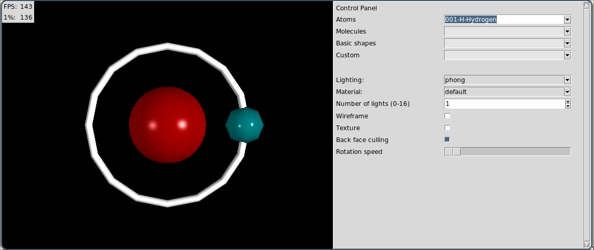

# Assignement 1: Computer Graphics
## Installation
From the root directory, install the necessary packages:
```shell
pip install -r "_Path_to_requirements.txt"
```
## Running the program
To start the program, from the root directory run:
```shell
python app.py
```
To start the program already rendering a specific scene, run:
```shell
python app.py --init_scene "scene_name_here_example_torus"
```
## Quick introduction
### GUI


The Viewport is on the left hand side, with a fixed width and height
The FPS (frames per second) and the 1%low (the lowest 1% FPS, ie how stuttery it is) is on the top left of the viewport

The Control Panel is on the right, you may need to expand the window to the right to reveal them.

From top to bottom, we have 4 categories of scenes: Atoms, Molecules, Basic Shapes, and Custom. Select a scene from the drop down next to the category to start rendering them. 

Note that some scenes need a bit of time to build if the shape is complex to generate from code. 

Custom -> file scene instructions will be in the next section

Next, we have a few parameters to tinker with the scenes. If the lighting mode is unwrap, the Rotation speed slider will instead control how unwrapped the shape's texture will be.

### Import files
When selecting Custom -> file, a new File path entry box appears. Input the path to an `.obj` file and hit `Enter` to parse and render that file. Note that any `.mtl` files that the `.obj` requires will need to be in the same directory as the `.obj` file.

Example files are provided at `inputs/obj` (all except for `inputs/obj/fromWiki.obj`, that is an example file that will not render)

<!-- ## Part I: Drawing basic shapes

### Default uniforms
Some uniforms are made available to shaders by default.
- `float iTime`: the time since the window opening, in seconds.
- `vec4 iMouse`: mouse info (xy: current if MLB down, zw: click).
- `vec2 iResolution`: the dimensions of the display window, in pixels.

- `mat4 model`: the model matrix to place an object in the world
- `mat4 view`: the tranform matrix from world to camera view
- `mat4 projection`: the transform matrix from camera view to screen
- `vec3 view_pos`: the world position of the camera

### Data Structure 
The pipeline rendering needs to be supplied with:
- **vertices**: np.array((n, 3))
- **indices**(optional): np.array((n)) if ommited, will be picking k-tuples from the vertices array where k is the size of primitive (eg 3 for triangles)
- **colors**: np.array((n, 3)) each component must be in [0, 1]
- **normals**: np.array((n, 3))
- **mode**: GL mode, indicating the rendering mode (eg: GL\_TRIANGLES, GL\_TRIANGL_STRIP, ...)

### Usage
```sh
python test/generators/generator.py --scene triangle 
python test/generators/generator.py --scene torus
python test/generators/generator.py --scene surface
python test/pipeline/lighting/sphere.py  # phong lighting
```

### Modules
#### Pipeline modules
- [x] different GL modes
- [x] different GL primitives
  - [x] triangles
  - [x] segments
  - [x] points
- [x] textures input
- [x] shaders files support
  - [x] uniforms
- [x] camera
- [x] Wireframe mode for visualizing only the edges of the shape.
- [x] lighting 
  - [x] Flat color (single uniform color for the entire object).
  - [x] Vertex color interpolation using Gouraud shading.
  - [x] Phong shading (with per-fragment lighting).
  - [x] Texture mapping using external image files provided by the user.
  - [x] multiple lights
  - [x] directional light
  - [x] puncual light
#### GUI modules
- [x] toolbar/menus
- [x] GL display (rendering loop, GL interface)
- [x] window 
- [x] mouse and time support
- [ ] keyboard interaction
- [x] fps

### 2D Shapes
- [x] triangle
- [x] rectangle
- [x] pentagon
- [x] regular hexagon
- [x] circle
- [x] ellipse
- [x] trapezoid
- [x] star
- [x] arrow

### 3D Shapes
- [x] basic solids
  - [x] cube
  - [x] sphere
  - [x] cylinder
  - [x] cone
  - [x] truncated cone
  - [x] tetrahedron
  - [x] torus
  - [x] prism.
- [x] Mathematical surface defined by a user-provided function z = f (x, y).
- [x] Imported 3D model from .obj or .ply file.


## Questions:
should the wireframe be able to be activated for each separately?
-> ie one parameter to toggle it globally (default behaviour) and one parameter for each object specifically

Currently: model matrix is static.
Consider making a class allowing the objects to move within the scene by modifying the model matrix (then the `model` uniform should become dynamic, maybe handled by a class similarly to the camera).

Same discussion with lights

Textures:
isTextured is never uploaded for "file" scenes
## TODO: 
Cache uniform locations. glGetUniformLocation with string formatting every frame is slow in Python. Build a dict of locations once after linking the program
allow per-scene lights definition -->
